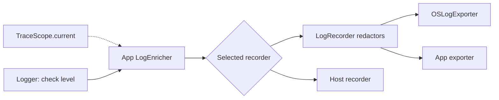

# Design decisions

[Documentation](../README.md#documentation) · [简体中文](design_CN.md)

An app chooses destinations at startup. A feature logs a fact or traces an operation. The following decisions describe where the app and Telescopium meet, and which object owns the work at that point.

## The app owns its telemetry backend

The Swift package exports one library. The app can use Apple's unified log and Instruments with the platform SDKs already in its build. An app that sends data to OpenTelemetry or Datadog can put the adapter in its own target or in a separate package. That owner selects the SDK version, initializes it, and configures sampling, storage, batching, and upload. Removing the two bundled adapters gave consumers control over their dependency graph while keeping the feature's logging calls stable. [Package manifest](../Package.swift)

Registration reflects two lifetimes. A logger can live as long as a feature and follow the app recorder on every call. An explicitly injected recorder stays bound to that logger. A span acquires its tracer at start and finishes with that tracer, even if the app changes registration while the operation is suspended. [Logger](../Sources/Log/Logger.swift) · [Scoped tracing](../Sources/Trace/WithSpan.swift)

## A log captures context before it enters a queue

Suppose Playback logs a retry during request A. By the time a worker exports it, request A has ended and the worker may have its own current span. Only the logging caller can reliably capture A's identity. The app therefore installs a `LogEnricher` that copies `TraceScope.current?.traceParent` into the new record before it reaches the selected recorder. Log needs just the shared `TraceParent` value. The app supplies the connection to Trace. [Correlation example](logging.md#correlate-logs-with-the-current-span)

Redaction has a different owner. A recorder with two exporters can remove a token once and send the same resulting value to both. `LogEnricher` and `LogRedactor` share the method `process(_:) -> LogRecord`. Each stage passes its returned value forward, and the built-in recorder controls its own redaction policy. This leaves a custom recorder free to implement its own policy. [Record processor](../Sources/Log/Protocols/Processor/LogRecordProcessor.swift) · [LogRecorder](../Sources/Log/LogRecorder.swift)

## Who creates the live span?

A destination that needs the final duration, metadata, or error can implement `SpanExporter`. A tracing SDK that chooses a span ID or sampling decision at the start of a request needs to create the live span itself. By the time an exporter receives a record, a child may already have sent the original ID across the network. `Tracer` gives the adapter that earlier entry point and associates it with its concrete `Span` type. [Tracer protocol](../Sources/Trace/Protocols/Tracer.swift) · [Exporter protocol](../Sources/Trace/Protocols/SpanExporter.swift)

The built-in tracer creates a shared `TelescopiumSpan` object so multiple holders can contribute to one operation. With an exporter, the first end takes its recording under a lock. The winner creates an immutable `SpanRecord`, converts the error to `ErrorInfo`, and calls the exporter after unlocking. A concurrent end cannot deliver a second record, and user code in an error description or exporter can run without holding the span lock. Wall-clock dates locate the operation on a timeline. A continuous clock measures elapsed time across wall-clock adjustments. [Active span](../Sources/Trace/Tracer/TelescopiumSpan.swift) · [Concurrency and clock tests](../Tests/TelescopiumTests/Trace/TelescopiumTracerTests.swift)

## The sampled flag and local export in 0.1.0

`TelescopiumTracer` starts a root span with trace flags `00` (`isSampled == false`). A child gets a fresh span ID and inherits its parent’s flags, including those received from a remote caller. The built-in tracer in 0.1.0 has no sampler. An app that needs to make a sampling decision when a root starts can register its own `Tracer`. [SpanContext](../Sources/Trace/Domain/SpanContext.swift) · [TraceParent](../Sources/Core/TraceParent/TraceParent.swift)

The exporter controls local recording independently of those flags. Suppose the app starts a `GET /orders` root with an exporter configured. When its network client injects that context, the `traceparent` header ends in `-00`. Ending the span for the first time delivers one complete `SpanRecord`. A child of a remote parent with flags `01` carries `01` even with no local exporter. In that case the span keeps its context, skips the recording state, lock, and clocks, and ignores metadata and events. [TelescopiumTracer](../Sources/Trace/Tracer/TelescopiumTracer.swift)

## The owner that starts an operation ends it

Most operations have a lexical end. `withSpan` binds the new context while the closure runs, restores the previous one, and ends the span through the tracer that started it. A thrown error takes the same path and reaches the caller. Code inside the closure can update the span while the wrapper owns its end. [withSpan](../Sources/Trace/WithSpan.swift)

A screen has separate open and close callbacks. Keeping an active span current for the entire wall-clock lifetime of that screen could attribute unrelated work to it. The screen owner can instead capture the matching start/end pair and call `withCurrent` around each action that belongs to the screen. The closing closure preserves the concrete tracer/span pairing required by Swift's associated type. [Screen example](tracing.md#keep-a-span-across-callbacks)

## Instruments observes the same lifetime

Signposts need a begin and an end while the interval is live. A completed record reaches an exporter too late to mark the start in Instruments. The `signposted(by:)` decorator observes both lifecycle calls, forwards updates to the underlying span, and uses the signposter the app supplies. The app controls the category and which builds or sessions enable profiling in one place. [SignpostTracer](../Sources/Trace/Tracer/SignpostTracer.swift)

## When to revisit delivery

Today the built-in tracer hands one completed record synchronously to one exporter. A host can fan out or enqueue records behind that interface. If several destinations need shared queue limits, a flush at app shutdown, or a defined policy for dropping records under load, those requirements would give a `SpanProcessor` a concrete job. Until then delivery policy belongs with the destination that knows its constraints.
