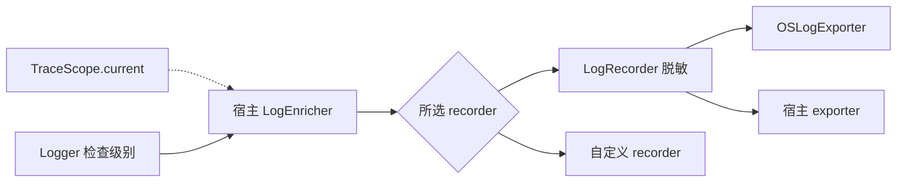

# 设计决策

[English](design.md) · [文档首页](../README_CN.md#文档)

App 在启动时选择出口，业务模块记录一条事实或跟踪一次操作。这里记下两者交接的位置，以及在这个位置上谁拥有状态、谁负责结束或交付。

## 遥测后端由 App 持有

Swift package 发布一个 library。只需要 Apple 统一日志和 Instruments 的 App 可以直接使用平台 SDK。要接 OpenTelemetry 或 Datadog，可以把适配器放在自己的 target 或独立包里。SDK 的版本、初始化、采样、存储、组批和上传都由接入方决定。移除内置的两个适配器后，宿主掌握自己的依赖图，业务侧仍然使用原有的日志入口。[Package 定义](../Package.swift)

注册要照顾两种生命周期。Logger 可以和业务模块一样长寿，每次打日志时读取当下的 App recorder。显式注入 recorder 后，该 logger 始终使用它。Span 则在开始时选定 tracer，即使操作挂起期间 App 重新注册，也会回到启动它的 tracer 结束。[Logger](../Sources/Log/Logger.swift) · [作用域实现](../Sources/Trace/WithSpan.swift)

## 日志在进入队列之前关联上下文

假设 Playback 在请求 A 中记了一条重试日志。等队列中的任务导出它时，A 已经结束，消费线程甚至可能正在处理另一个 span。能够可靠读到 A 身份的位置，是当初调用 logger 的地方。因此 App 注册一个 `LogEnricher`，在新记录交给所选 recorder 前，把 `TraceScope.current?.traceParent` 复制进去。Log 只依赖共享的 `TraceParent` 值。把它和 Trace 接起来的是宿主。[关联示例](logging_CN.md#在打日志时关联当前-span)

脱敏由 recorder 负责。假设它接了两个出口，移除一次 token，就能把同一份结果发给两边。`LogEnricher` 和 `LogRedactor` 共享处理方法 `process(_:) -> LogRecord`，每一步都把返回值传给下一步。内置 recorder 在分发前执行自己的脱敏策略，自定义 recorder 也可以选择适合自己的策略。[公共处理协议](../Sources/Log/Protocols/Processor/LogRecordProcessor.swift) · [LogRecorder](../Sources/Log/LogRecorder.swift)

## 谁创建活跃 span

出口只关心最终耗时、metadata 或错误时，实现 `SpanExporter` 就够了。另一类接入需要在请求发起时由底层 SDK 选择 span ID 或做采样决定。等 exporter 收到快照，子请求可能早已把原来的 ID 发到了下游。`Tracer` 把接入点提前到创建时，并用关联类型表达该实现创建的具体 `Span`。[Tracer 协议](../Sources/Trace/Protocols/Tracer.swift) · [Exporter 协议](../Sources/Trace/Protocols/SpanExporter.swift)

内置实现创建一个共享的 `TelescopiumSpan` 对象，让不同持有者都能更新同一次操作。配置 exporter 后，首次结束的调用在锁内取走记录状态，随后在锁外生成不可变的 `SpanRecord`、将错误转换为 `ErrorInfo` 并调用 exporter。并发结束只会交付一次，读取业务错误描述和执行 exporter 时都已释放 span 的锁。墙钟起止时间用来对齐事件，连续时钟则在系统校时的情况下仍能给出经过的时长。[活跃 span](../Sources/Trace/Tracer/TelescopiumSpan.swift) · [并发与时钟测试](../Tests/TelescopiumTests/Trace/TelescopiumTracerTests.swift)

## 0.1.0 的 sampled 位与本地导出

`TelescopiumTracer` 创建根 span 时将 trace flags 设为 `00`（`isSampled == false`）。子 span 获得新的 span ID，并继承父级的 flags，包括远端调用方传来的值。0.1.0 的内置 tracer 没有 sampler。需要在根 span 创建时做采样决定的 App，可以注册自己的 `Tracer`。[SpanContext](../Sources/Trace/Domain/SpanContext.swift) · [TraceParent](../Sources/Core/TraceParent/TraceParent.swift)

本地是否记录由 exporter 决定，与传播的 flags 相互独立。假设 App 为 `GET /orders` 创建根 span，并配了 exporter。网络层将该上下文写入请求时，`traceparent` 头以 `-00` 结尾。第一次结束这个 span 仍会交付一份完整的 `SpanRecord`。远端父级传入 `01` 时，即使本地没有 exporter，子 span 也会继续携带 `01`。此时 span 只保留上下文，省去记录状态、锁和时钟，也跳过 metadata 与事件的写入。[TelescopiumTracer](../Sources/Trace/Tracer/TelescopiumTracer.swift)

## 谁启动，谁负责结束

常见操作随着闭包返回而完成。`withSpan` 将新上下文绑定到闭包的执行范围，恢复原上下文后，调用最初的 tracer 结束 span。闭包抛错时，原始错误沿同一路径交回调用方。闭包里的代码可以更新 span，结束的时机由外层掌握。[withSpan](../Sources/Trace/WithSpan.swift)

页面的打开和关闭分属不同回调。如果页面整个存续期间都把它的 span 当成 current，无关的工作也可能被归到这个页面下。页面可以捕获匹配的启动与结束操作，只在自己的某次行为期间用 `withCurrent` 临时绑定上下文。结束闭包保存了 Swift 关联类型所要求的具体 tracer/span 配对。[跨回调示例](tracing_CN.md#跨回调持有-span)

## Instruments 观察同一个生命周期

Signpost 需要在区间实际开始和结束时分别打点。Exporter 收到的是完成后的快照，已经错过在 Instruments 中标记起点的时机。`signposted(by:)` 装饰器同时观察开始与结束，将 span 更新转发给底层实现，并使用 App 提供的 signposter。在哪些构建或采集会话中启用、使用哪个 category，都可以在宿主组装 tracer 时决定。[SignpostTracer](../Sources/Trace/Tracer/SignpostTracer.swift)

## 何时重新讨论交付机制

当前内置 tracer 将一条完成记录同步交给一个 exporter。宿主可以在其后按需分发或入队。将来如果几个目的地都需要共享队列容量、退出时统一 flush，或约定过载时如何丢弃记录，`SpanProcessor` 就有了可说明的职责。在这些需求出现前，交付策略跟着了解自身约束的出口走。
